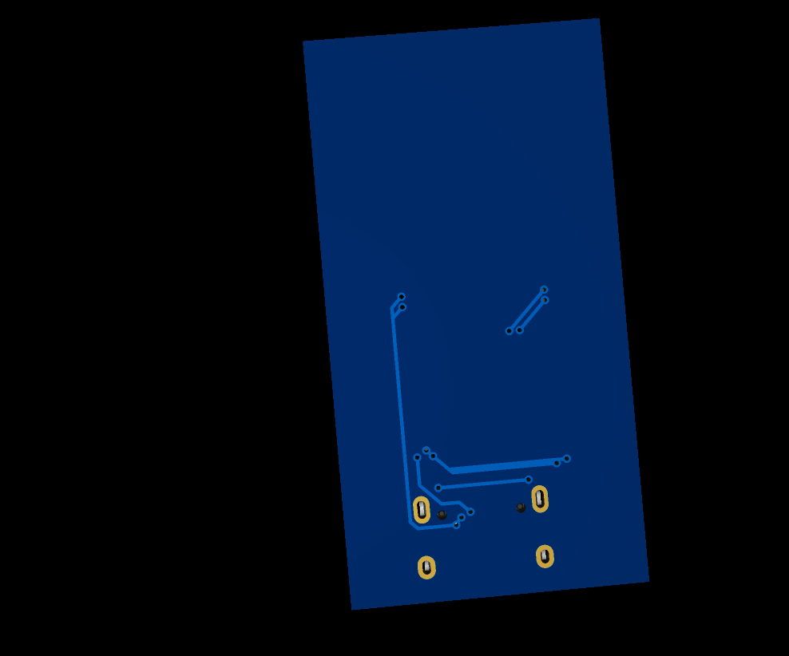
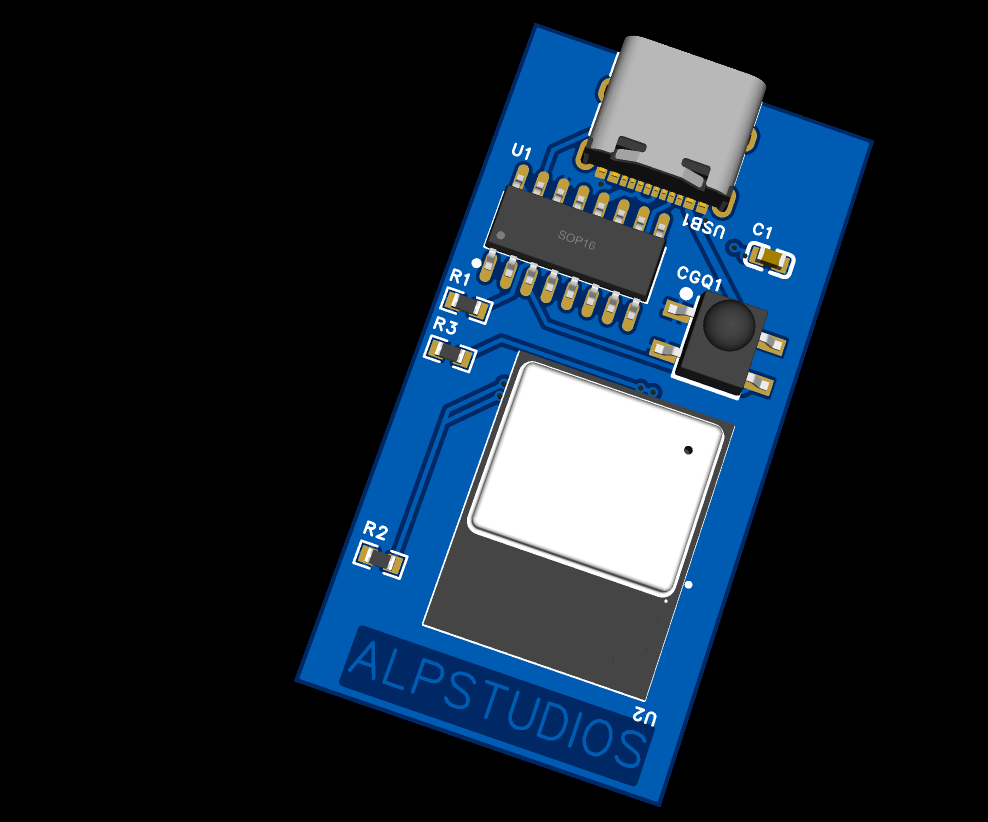
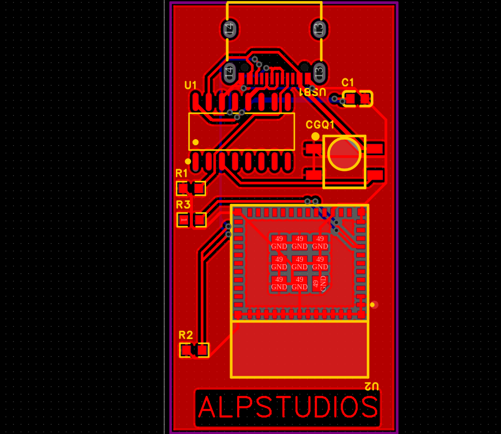

# CONTBTIR
## Universal PC Remote Control Board – IR, Bluetooth & USB

   

 <b>One Board. Multiple Control Methods. Complete PC Control.</b> 

        

📌 1. Project Overview

CONTBTIR is a compact, multifunctional PC remote control board designed to control a computer using a single hardware device.

The main purpose of this project is to combine multiple remote-control technologies into one PCB, eliminating the need for separate USB adapters and wireless receivers.

The board is designed around two main microcontrollers:

CH552G: Handles USB communication and the PC interface.
ESP32-C3: Provides wireless communication capabilities, including Bluetooth.

The intended functionality includes:

Infrared (IR) remote control.
Bluetooth wireless control.
USB communication with a computer.
Remote PC control through a single compact board.

The project aims to provide a simple and flexible solution for controlling a PC remotely using an ordinary IR remote or a Bluetooth-compatible device.

✨ 2. Main Features
Single-board PC remote control solution.
CH552G USB controller.
ESP32-C3 wireless controller.
Infrared remote control support.
Bluetooth Low Energy (BLE) capability.
USB connectivity.
Compact custom PCB design.
Independently programmable microcontrollers.
Accessible firmware programming points.
No need to directly touch tiny IC pins during programming.
🖥️ 3. PCB Design

The PCB has been designed to integrate the main components and communication interfaces into a single board.

3D PCB Visualization

  

  

3D visualization of the CONTBTIR hardware design.

⚡ 4. Circuit Schematic

The complete electrical schematic is provided below.

  

The schematic contains the electrical connections between the CH552G, ESP32-C3, USB interface, power circuitry and other PCB components.

🧠 5. Hardware Architecture

CONTBTIR uses two independent microcontrollers.

5.1 CH552G – USB Controller

The CH552G is responsible for the USB-side functionality.

Its intended responsibilities include:

USB communication with the computer.
USB interface management.
Handling PC-side communication.
Processing or forwarding control commands.

The CH552G can be programmed independently through its USB bootloader.

5.2 ESP32-C3 – Wireless Controller

The ESP32-C3 provides the wireless communication capabilities.

Its intended responsibilities include:

Bluetooth Low Energy communication.
Wireless command reception.
Communication with the CH552G.
Handling wireless control functionality.

The ESP32-C3 has a separate firmware programming procedure.

🔧 6. Firmware Programming Guide

One of the most important design features of CONTBTIR is its easily accessible programming points.

Both microcontrollers can be placed into programming mode without directly touching their small IC pins.

Only a pair of fine-tipped conductive tweezers is required to activate the programming points.

There are two separate programming procedures.

6.1 CH552G Firmware Programming
Programming Mode Activation Through C1

The CH552G uses its USB bootloader for firmware uploading.

On this PCB, the programming activation point is accessible through capacitor C1.

Instead of touching the tiny CH552G pins, users can activate the programming mode directly through the two terminals of C1.

📍 Programming Point Location

  

Programming point: Both terminals of capacitor C1.

Step-by-Step Instructions
Locate capacitor C1 on the right-hand side of the PCB.
Prepare a pair of conductive tweezers.
Place one tweezer tip on the first terminal of C1.
Place the other tweezer tip on the second terminal of C1.
Temporarily bridge both terminals.
While maintaining the connection, connect the board to your computer through USB.
Release the tweezers after the bootloader entry sequence.
The computer should detect the CH552G bootloader.
Upload the firmware using a compatible CH552G flashing tool.
Why Does This Work?

In this PCB design, one terminal of C1 is connected to the V33 supply, while the other terminal is connected to the filtered UDP (USB D+) line.

Temporarily bridging these terminals pulls the USB data line to the required logic level for the intended programming-entry sequence.

This allows the user to activate the CH552G bootloader without directly accessing the microcontroller pins.

Quick Summary
Item	Description
Microcontroller	CH552G
Component	C1
Programming point	Both capacitor terminals
Required action	Temporarily bridge both terminals
Connection	USB
Result	USB bootloader activation
⚠️ IMPORTANT: Never leave C1 permanently shorted. Confirm the schematic connections before performing this procedure. Avoid accidentally connecting V33 to GND.
6.2 ESP32-C3 Firmware Programming
Programming Mode Activation Through R3

The ESP32-C3 has a separate firmware programming interface.

The ESP32-C3 enters its download mode when GPIO9 is held LOW during the appropriate reset sequence.

On this PCB, the GPIO9 programming point is accessible through resistor R3.

This avoids the need to touch the tightly spaced pins underneath the ESP32-C3 module.

📍 Programming Point Location

  

Programming point: Lower terminal of R3, close to the ESP32-C3 module.

Step-by-Step Instructions
Locate the ESP32-C3 module, identified as U2.
Find resistor R3, immediately to the upper-left of the module.
Identify the lower terminal of R3, closer to the ESP32-C3 module.
Prepare conductive tweezers.
Touch one tweezer tip to the lower terminal of R3.
Touch the other tweezer tip to the PCB GND plane.
Alternatively, use the USB connector's metal shell if it is electrically connected to GND.
This temporarily pulls GPIO9 LOW.
While holding GPIO9 LOW, reset or power-cycle the ESP32-C3.
Release the connection after the chip enters download mode.
Connect to the ESP32-C3 using a compatible flashing tool.
Upload the firmware.
Why Does This Work?

The ESP32-C3 uses GPIO9 as a boot-strapping pin.

When GPIO9 is held LOW during reset, the chip enters its serial download boot mode instead of executing the normal application firmware.

R3 provides an accessible connection to this programming signal.

This makes firmware uploading easier without touching the ESP32-C3 module's tiny pins.

Quick Summary
Item	Description
Microcontroller	ESP32-C3
Component	R3
Programming point	Lower terminal of R3
Required connection	GPIO9 to GND
Timing	During reset or power-up
Result	Download mode
⚠️ IMPORTANT: GPIO9 must be LOW when the ESP32-C3 samples its boot configuration during reset. Grounding GPIO9 after the chip has already started running may not activate download mode.
🔍 7. Programming Points – Comparison

Both microcontrollers have dedicated and easily accessible programming points.

Feature	CH552G	ESP32-C3
Component	C1	R3
Programming signal	UDP / USB D+	GPIO9
Activation method	Bridge both C1 terminals	Connect GPIO9 to GND
Required tool	Tweezers	Tweezers
Connection	USB	USB
Programming mode	USB bootloader	Serial download mode
Direct IC pin access	Not required	Not required
Programming Point Reference

CH552G:

C1 Terminal 1 + C1 Terminal 2 → Temporary Bridge → USB Connection

ESP32-C3:

R3 GPIO9 Terminal + GND → GPIO9 LOW → Reset → Download Mode

💻 8. Firmware Development

The project uses two independently programmable microcontrollers.

Each microcontroller requires its own compatible firmware.

CH552G Development

The CH552G firmware handles USB-side functionality.

Compatible development and flashing environments can be used to compile and upload the firmware.

ESP32-C3 Development

The ESP32-C3 firmware handles wireless functionality.

Supported development environments include:

ESP-IDF.
Arduino IDE with ESP32 board support.
Other compatible ESP32-C3 development environments.

Note: Firmware source code and detailed software configuration instructions will be added to the repository as development progresses.

📦 9. PCB Manufacturing Files

The repository contains the hardware files required for PCB manufacturing and assembly.

File	Description
3d1.png	PCB 3D visualization
3d2.png	Alternative PCB 3D visualization
schem.png	Electrical schematic
BOM_Board1_PCB1_2026-10-30.xlsx	Bill of Materials
PickAndPlace_PCB1_2026-10-30.xlsx	Pick and Place coordinates
Gerber_PCB1_2026-10-30.zip	PCB manufacturing files
Gerber Files

The Gerber archive contains the manufacturing data required by PCB fabrication services.

Bill of Materials (BOM)

The BOM spreadsheet lists the electronic components required to assemble the PCB.

Pick and Place

The Pick and Place spreadsheet contains component placement coordinates for automated assembly.

⚠️ 10. Safety and Programming Precautions

Please read these precautions before programming the board.

Always verify the programming points against the electrical schematic.
Use fine-tipped conductive tweezers.
Avoid accidentally shorting neighboring component pads.
Never leave C1 terminals permanently connected.
Never short V33 directly to GND.
Make sure the USB connector is correctly connected.
Do not apply external voltage to USB data lines.
Verify the R3 GPIO9 connection before programming.
Ensure GPIO9 is LOW during the appropriate reset sequence.
Use the correct firmware for each microcontroller.
Avoid programming both microcontrollers simultaneously unless the hardware and firmware explicitly support it.

Incorrect connections may permanently damage the PCB or its components.

📂 11. Repository Structure
text
CONTBTIR/
│
├── README.md
├── LICENSE
│
├── 3d1.png
├── 3d2.png
├── schem.png
│
├── BOM_Board1_PCB1_2026-10-30.xlsx
├── PickAndPlace_PCB1_2026-10-30.xlsx
├── Gerber_PCB1_PCB1_2026-10-30.zip
│
└── docs/
    └── images/
        ├── ch552g-c1-programming.png
        └── esp32c3-r3-programming.png

🚀 12. Future Development

Potential future improvements include:

Expanded IR remote compatibility.
Custom Bluetooth control software.
Wireless PC command interface.
Additional remote-control functions.
Improved firmware management.
Dedicated PC control application.
Additional configuration and customization options.
🎯 13. Project Goal

The main goal of CONTBTIR is to make PC remote control easier by combining multiple technologies into one compact hardware platform.

Instead of using separate infrared receivers, Bluetooth adapters and additional control hardware, CONTBTIR aims to provide a unified solution.

Its accessible programming points also make firmware development and hardware maintenance easier.

One PCB. Two microcontrollers. Multiple ways to control your PC.

📜 14. License

This project is distributed under the license specified in the repository's LICENSE file.

Please review the license before using, modifying or distributing the hardware design.

👨‍💻 15. Author

ALP GIRAY ALTUNSOY

Project: CONTBTIR

GitHub Repository:

https://github.com/alpgirayaltunsoy-alp/CONTBTIR

 <b>CONTBTIR</b>   Universal PC Remote Control Board   IR • Bluetooth • USB    <i>One Board, Multiple Ways to Control Your PC.</i> 

